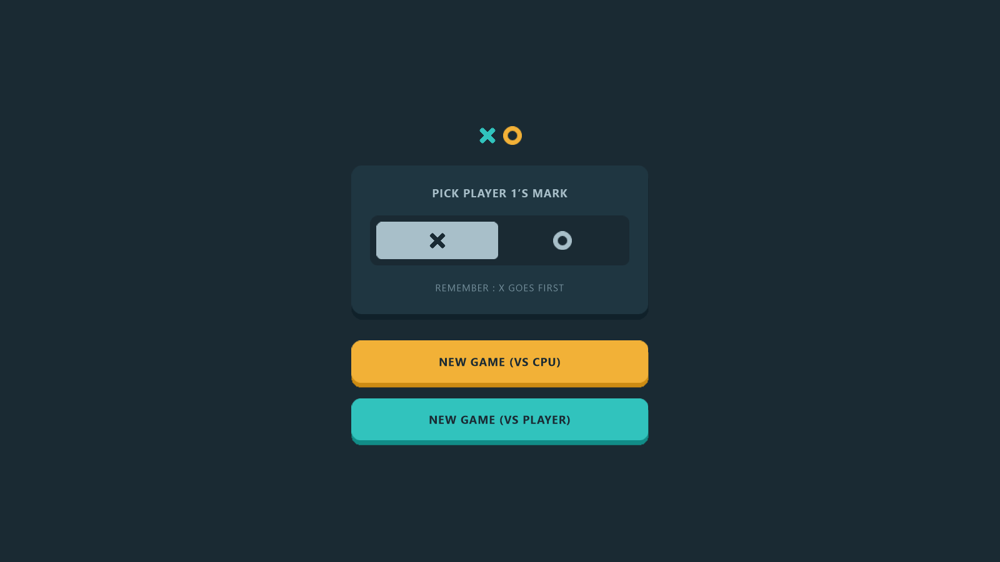
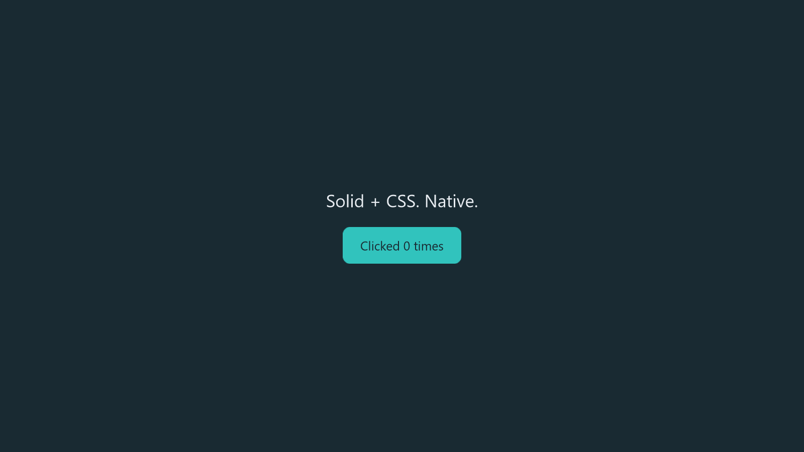
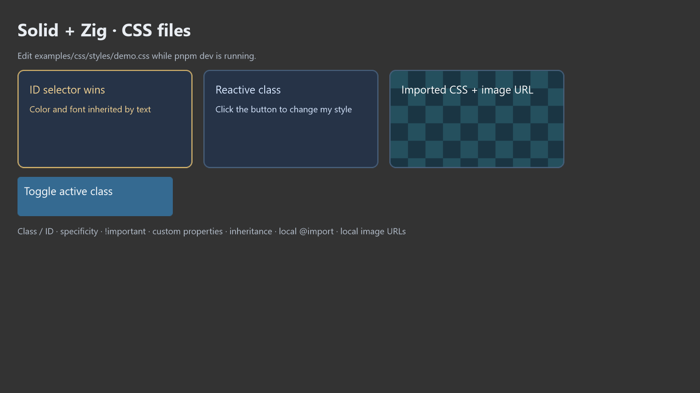

# Solid Native · Zig

**Write native desktop interfaces with Solid JSX and ordinary CSS, powered by Zig. No WebView.**

The goal is a small, approachable native UI toolkit: compose components, manage state with Solid, import a `.css` file, and let the native runtime handle layout, text, drawing and input. Application code stays in familiar JSX and CSS; the engine underneath is Zig.

**Status:** experimental, with a working Windows host and runnable examples. The project uses Solid **2.0.0-rc.21**. There is no published SDK yet; CSS support is a subset and HMR needs substantial hardening. Other platform hosts are future work.



*Actual native framebuffer from the [tic-tac-toe example](examples/tictactoe/App.jsx), using Solid, CSS, the Zig renderer and DirectWrite text. The game includes player/CPU modes, scores and round-result overlays. [Screenshot provenance](docs/images/README.md).*

[Try it](#run-it-on-windows) · [Small example](#a-small-complete-example) · [What works](#what-works-today) · [Roadmap](#where-this-is-going) · [Development guide](docs/development.md)

## A small, complete example

A signal, a button and a normal stylesheet. This is the complete component in [examples/counter/App.jsx](examples/counter/App.jsx):

```jsx
import { createSignal } from "solid-js";
import "./app.css";

export default function App() {
  const [count, setCount] = createSignal(0);
  return (
    <div class="counter">
      <div>Solid + CSS. Native.</div>
      <button onClick={() => setCount(count() + 1)}>
        {`Clicked ${count()} times`}
      </button>
    </div>
  );
}
```

The accompanying [app.css](examples/counter/app.css) controls layout, typography and hover:

```css
.counter {
  display: flex;
  flex-direction: column;
  align-items: center;
  justify-content: center;
  height: 100vh;
  gap: 24px;
  background-color: #192a32;
  color: #e9edf2;
  font-family: system-ui;
  font-size: 28px;
}

.counter button {
  padding: 16px 28px;
  border-radius: 12px;
  background-color: #31c3bd;
  color: #192a32;
  font-size: 20px;
  cursor: pointer;
}

.counter button:hover {
  background-color: #65e9e4;
}
```

Mount it in [app.js](examples/counter/app.js):

```js
import { mountApp } from "@zig-ui/solid";
import App from "./App.jsx";

mountApp(App);
```



*The same component and stylesheet running natively. Clicking the button updates its text through Solid's signal. The screenshot shows the initial state; it is a static capture.*

After setup, run `pnpm dev --example counter`. There is no per-example Zig code or separate package installation. The repository supplies the shared native host and Vite configuration.

## Run it on Windows

Requires **Zig 0.17.0**, **Node.js**, **pnpm** and **Git**. Run these commands from the repository root:

```powershell
node tools/setup.mjs
pnpm install --frozen-lockfile
pnpm dev --example counter
```

Setup fetches the pinned QuickJS-NG source. `pnpm dev` starts Vite, builds the development bootstrap and launches the native application. Closing the app stops the owned Vite server; Ctrl+C stops the owned native process tree.

To build and run a production bundle:

```powershell
pnpm build:ui --example counter
zig build run
```

The production UI bundle embeds local image assets and runs without a Vite server. This is a source-build workflow; a standalone SDK or installer is not provided yet.

## Explore the examples

| Example | What it demonstrates | Run |
| --- | --- | --- |
| [Counter](examples/counter/App.jsx) | Minimal component, signal updates, imported CSS and hover | `pnpm dev --example counter` |
| [CSS](examples/css/App.jsx) | Reactive classes, cascade, variables, inheritance, local imports and embedded images | `pnpm dev --example css` |
| [Tic-tac-toe](examples/tictactoe/App.jsx) | Solid control flow, game state, CPU timers, CSS board, scores and overlays | `pnpm dev --example tictactoe` |
| [States and cities](examples/states/States.jsx) | Async loading and dependent select controls using local delayed fixture data | `pnpm dev --example states` |



*The CSS example exercises real stylesheet imports and native rendering. Its toggle changes a card's class reactively. [Read the source stylesheet](examples/css/styles/demo.css).*

Omitting `--example` selects `css`. Run one example at a time: the examples share generated bundles and the native executable. See the [examples guide](examples/README.md) to add your own.

## What works today

- **Solid reactivity and components.** The pinned Solid client runtime supplies signals, effects, memos, stores, lifecycle hooks, context and control flow. A universal renderer connects the resulting nodes to the native host.
- **CSS files end to end.** Import `.css` files and use `class`, `classList`, IDs, custom properties, inheritance, supported selectors and cascade rules. Styles resolve into the native retained tree.
- **Native layout and painting.** Block, flex and grid layout, positioning, scrolling, text editing, rounded corners, gradients, shadows, clipping, transforms, opacity and runtime transitions have implementations and targeted tests. Support varies by property and value.
- **Windows text.** DirectWrite shares shaped layouts between measurement, painting, caret hit testing and horizontal selection. Glyph coverage is rendered at device resolution.
- **Work scheduled by changes.** The bridge separates layout, paint, interaction and motion inputs. The host waits for events while idle and can process unchanged input without drawing or swapping buffers. Timers and transitions schedule further work.
- **An existing development loop.** Vite builds JSX and styles and delivers updates to QuickJS. Basic updates work, but failed updates, cleanup and recovery have known defects tracked in the [HMR audit](docs/audit/hmr-bridge.md).

These are working implementation areas, not a claim of complete browser compatibility or production readiness. The [development guide](docs/development.md) describes the supported CSS subset, host restrictions and checks.

## How it works

```text
Your Solid components + CSS
             |
      Vite + Solid compiler
             |
     JavaScript in QuickJS-NG
             |
   Retained nodes + changed inputs
             |
    Zig layout, input and painting
             |
   Native Windows window + DirectWrite
```

Vite runs during development or bundling. QuickJS runs the application JavaScript inside the native executable. JSX elements such as `<div>` and `<button>` become nodes in our retained UI tree. Zig lays out and paints those nodes and routes input back to Solid by node ID.

The current compositor uses Raylib/OpenGL, with DirectWrite for Windows text. These are implementation choices being evaluated as the toolkit develops.

| Part | Responsibility |
| --- | --- |
| [Solid adapter](packages/solid-zig) | Universal renderer, CSS runtime, node changes and module host |
| [UI core](modules/ui_core) | Backend-independent retained storage, styles, layout, hit testing, scrolling and editing state |
| [Solid bridge](modules/solid_bridge) | QuickJS runtime, jobs, timers and the native change/input interface |
| [Windows application](src) | Window, renderer, text backend, input and development watchers |

## Where this is going

The vision is to make everyday native application development feel as direct as writing a Solid component and a stylesheet: reusable UI, dependable iteration, good text and input, accessibility, and measurable control over runtime work and memory.

The next work is about making that foundation reliable and testable. **The items below are planned; merging the planning documents did not implement them.**

| Workstream | Intended result | Plan and tracking |
| --- | --- | --- |
| HMR reliability | Consistent update ownership, failure recovery, cleanup, diagnostics and end-to-end regression coverage | [Audit and evidence](docs/audit/hmr-bridge.md) · [#364](https://github.com/RoboXGamer/SolidNativeZigExperiment/issues/364) |
| Shared clock + app driver | Controlled time, deterministic scheduling, shared input delivery and frame barriers for repeatable native tests | [Two tasks, one implementation PR](docs/plans/clock-driver.md) · [#343](https://github.com/RoboXGamer/SolidNativeZigExperiment/issues/343) |
| Windows host integration | UI Automation, IME, accessible text, keyboard conventions, DPI/settings changes and desktop integration | [17 scoped tasks](docs/plans/windows-host.md) · [#346](https://github.com/RoboXGamer/SolidNativeZigExperiment/issues/346) |
| Memory and layout efficiency | Measured allocation/resource budgets and an isolated compact-layout experiment | [Rune adaptations](docs/plans/rune-adaptation.md) · [#377](https://github.com/RoboXGamer/SolidNativeZigExperiment/issues/377) · [#378](https://github.com/RoboXGamer/SolidNativeZigExperiment/issues/378) |
| Rendering correctness and backend choice | Replayable rendering failures, reference comparisons and matched quality/performance evidence before selecting backends | [Rendering plan](docs/plans/rune-adaptation.md#6-differential-rendering-with-minimized-replayable-failures) · [#379](https://github.com/RoboXGamer/SolidNativeZigExperiment/issues/379) · [#380](https://github.com/RoboXGamer/SolidNativeZigExperiment/issues/380) |
| Easier adoption | Package the adapter/SDK for use outside this checkout | [#333](https://github.com/RoboXGamer/SolidNativeZigExperiment/issues/333) |

The [implementation index](docs/plans/exact-tracking.md) connects the plans and issue dependencies. We are learning from [Expo Exact](https://github.com/expo/exact) and [Rune](https://github.com/anomalyco/rune), adapting their ideas to this Solid/Zig architecture. Taffy, ThorVG and alternative GPU/text backends are candidates for evaluation; no replacement is selected. The existing implementation can remain if it wins the comparison.

## Current boundaries

- **Windows is the working host.** The reusable core is separated from platform code, but working macOS, Linux and mobile hosts are not provided.
- **Native elements are toolkit-rendered.** Familiar JSX tags do not imply browser DOM APIs or Windows system widgets. Complete controls, accessibility and IME behavior remain active roadmap work.
- **CSS is a supported subset.** Full browser cascade/query conformance, CSS Modules, `@font-face`, `@keyframes`, remote assets and full multi-layer image semantics are not available. Parsing a property does not establish native support for every value.
- **The embedded host has limits.** Browser DOM APIs, Node built-ins, computed dynamic imports and top-level-await application modules need additional host support.
- **HMR is experimental.** Component state may reset, runtime updates are not transactional, and the audit records reproducible edge-case failures. Restart the app after changing Zig, the renderer/host or Vite configuration.
- **Performance work is ongoing.** Paint textures and computed styles are cached, but tree/layout updates still rebuild the scene. No cross-toolkit performance or memory advantage is claimed without matched measurements.

## Development and verification

```powershell
pnpm test                 # JavaScript, adapter, CSS and example checks
zig build test            # UI core tests
zig build test-native     # Windows text and native framebuffer checks
pnpm build:ui --example css
zig build
pnpm test:smoke           # Embedded Solid/QuickJS + native application smoke
```

The [development guide](docs/development.md) includes CSS bundle/HMR checks, hover and frame-scheduling regressions, the two-terminal workflow and dependency notices. Screenshots demonstrate captured output; test coverage and remaining validation limits are documented separately.

Further reading: [native text](docs/native-text.md) · [frame scheduling](docs/native-frame-scheduling.md) · [change discovery](docs/change-discovery.md) · [hover investigation](docs/hover-input-latency.md) · [CSS implementation handoff](docs/tasks/phase-e-broaden-css.md).
